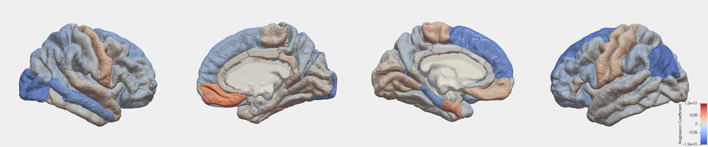
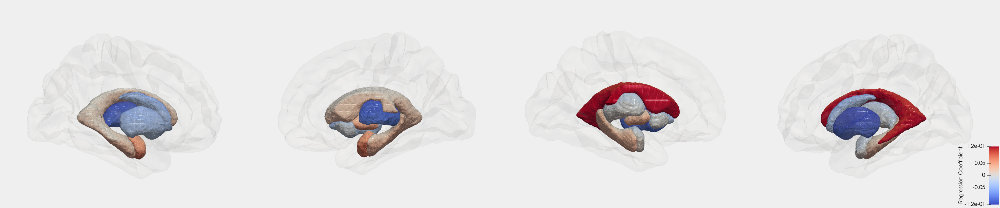
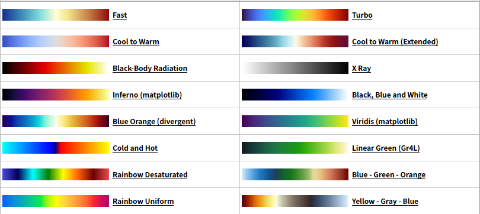
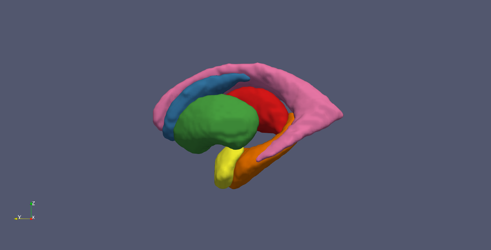
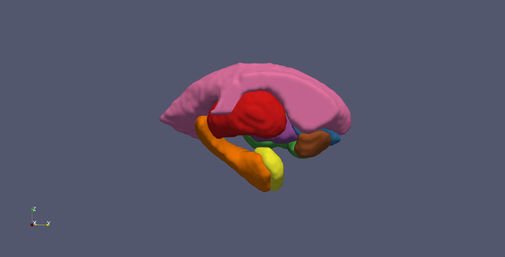
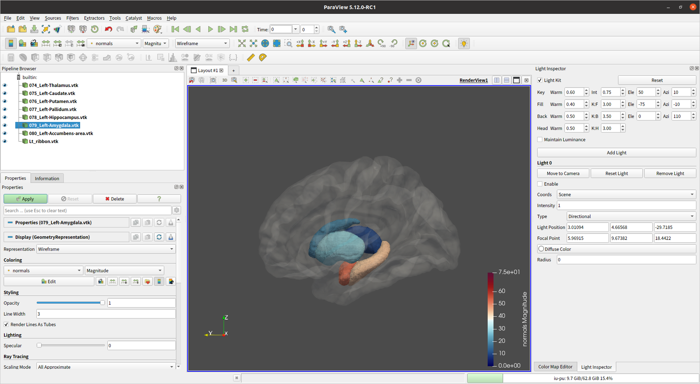
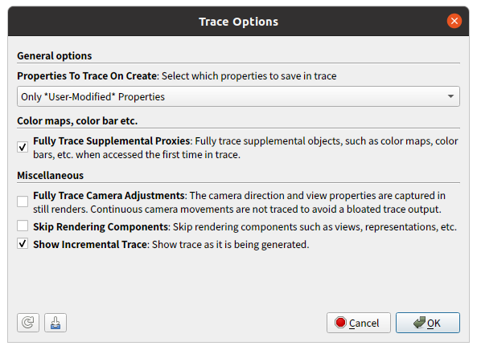

# BrainGraph with ParaView 


Last Updated: 2025.05.27


これはParaViewを利用して、脳の三次元グラフを生成するためのスクリプト集です。


 

-------- 

## 使い方

以下のような3ステップで、上記のようなグラフを簡単に作成できます。

**Step 1: 領域名と値を対にしたテキストファイル(tsv)を用意する。**
  * 脳領域名は VtkFileTable.tsv で定義されている名前を使うこと。
  * 脳領域名の右隣に値を記述する。脳領域名と値の間にはタブを入れる。
  * ./SampleValuesForCorticalAreas.tsv, ./SampleValuesForSubCorStructures.tsv を参考にしてください。 

**Step 2: config.ini ファイルで tsvファイルの所在、値範囲、出力先等を指定する。**
  * ./config_default.ini を参考にしてください。

**Step 3: 生成コマンドを走らせる**
  * 以下のいずれかを走らせる
    * ``bash generate_horizontally_with_vertical_cbar.sh``
    * ``bash generate_horizontally_with_horizontal_cbar.sh``
    * ``bash generate_vertically_with_vertical_cbar.sh``
    * ``bash generate_vertically_with_horizontal_cbar.sh`` を走らせてください。
  * これらのスクリプトの実行には、ParaView（インストール方法は[下の方](#インストール方法)を参照）、および同階層に置かれた Infuse_Values_into_VTK_File.py, PvpythonScript_Make_Figure.py, MergePngVertically.py, MergePngHorizontally.py, config.ini が必要。python library "pands"、"Pillow" も必要。


-------- 

## 連続表面モード（surface_mode = painted）

Last Updated: 2026.10.23

皮質の領域を 1 枚ずつ別のメッシュとして描くと、領域の境界に隙間が出て、縁がボクセルの階段状のまま残る。
`surface_mode = painted` では、半球全体の連続した皮質表面を領域のラベルで塗り分けるので、隙間が出ない。
config.ini に `surface_mode` がなければ従来どおり（`parcels`）に動く。

### 使い方

config.ini に次を加える（キーの一覧と既定値は config_default.ini）。

    surface_mode = painted
    atlas = DK
    border_opacity = 0        # 0.3〜0.5 にすると領域の境界に細い線が出る
    representation = Surface  # 深部構造を滑らかに描く（Wireframe は従来の点描風）
    LUT = 'Reds'              # 0 から増える値は ParaView の単色系プリセット + 下の反転
    lut_invert = true

値表は従来と同じ（`OBJECT_LABEL<TAB>VALUE`）。値が空または `NA` の領域（皮質も深部構造も）は `na_color` で塗られる。
皮質の領域と深部構造は、別々の値表で別々に生成する（皮質の値表に深部構造は含めない）。

設定ファイルの場所は環境変数 `BRAINGRAPH_CONFIG` で替えられる（既定は `./config.ini`）。呼び出し側のプロジェクトが、
このツールの config.ini を書き換えずに実行するための仕組み。

生成スクリプト（generate_*.sh）は、`vtk/labeled/<atlas>/` がなければ `Build_Labeled_Surfaces.py` を自動で走らせる。
手で走らせるときは、このフォルダで `pvpython Build_Labeled_Surfaces.py [--atlas DK] [--check-report]`。

### 仕組み

  1. `Build_Labeled_Surfaces.py` が、半球全体の表面（`vtk/without_val/Lt_ribbon.vtk` など）を三角形化・平滑化し、
     各頂点に最寄りの領域メッシュのラベルを付け、近傍の多数決で滑らかにして、面ごとのラベルとして `vtk/labeled/<atlas>/` に保存する。
     値には依存しないので、値表を替えるたびに作り直す必要はない。
  2. `PvpythonScript_Make_Figure.py` が値表の値を面ごとに割り当てて塗る。

  * 結果は決定的で、同じ入力・同じパラメータなら出力のバイトまで一致する。
  * 再現性の検査: `expected/<atlas>_report.tsv`（領域ごとの面数）と照合する。`pvpython Build_Labeled_Surfaces.py --check-report`。
    画像の画素は GPU やドライバで変わりうるので、検査には使わない。
  * パラメータ（転写の最大距離、ラベル平滑化の回数など）は config.ini の `[Labeling]` で変えられる。変えたら report が変わる。

### 既知の制約

  * `representation = Surface` では、深部構造のメッシュを描画時に平滑化し、法線を計算し直している。
    これは、値が vtk の `normals` 欄に入っていて、ParaView がそれを照明用の法線として使ってしまうため。
  * 領域内の値は一様に塗られる。値表が大領域ごとの値なら、同じ領域の DK 領域は同じ色になる。

### 将来の atlas 追加（例: HCP-MMP）— 未実装。方法の概要

領域ごとの vtk を ITK-SNAP の GUI で 1 ラベルずつ書き出す工程は、360 領域の atlas では現実的でない。
連続表面モードは、ラベルが表面の頂点に届けばよい作りなので、次の方法で足せるはず。

  1. fsaverage 上の annot（HCP-MMP など）から、体積ラベルを作る（FreeSurfer の `mri_aparc2aseg --annot` など）。
  2. `atlases/<name>.ini` に `source_type = label-volume` とラベル体積の場所を書く。`labels_table` には `OBJECT_LABEL`、`HEMI`、
     体積中のラベルの整数値を並べる。
  3. `Build_Labeled_Surfaces.py` に `label-volume` の読み込みを実装する（体積を表面の頂点位置でサンプリングし、
     その後の多数決の平滑化と面ラベル化は共通）。
  4. config.ini の `atlas = <name>` を替える。

実施前に確かめること: 表面（`Lt_ribbon.vtk`）の元になったラベル体積の空間と解像度（この README に記録がない）に、
新しい体積ラベルを合わせられるか。領域数が多いと 1 領域あたりの頂点が減るので、多数決の平滑化で細い領域が痩せないか
（report の面数の変化で見る）。

-------- 

## ファイル・フォルダの説明と主要スクリプトファイルの使い方


### vtk/
  * vtk/without_val: 型となるvtkファイルが置かれている場所
  * vtk/with_val: 自動生成されるvtkファイルが置かれる場所

### config.ini

以下のような内容とする。

    [Settings]
    #
    # value_table_file
    # (Please over write the templates)
    # 
    ValueName = 'Correlation Coefficient'
    value_table_file='./ValueTables/SampleValues.tsv'
    Unit = ''
    output_folder = './png'
    value_range_ul_on_figure = 0.4
    value_range_ll_on_figure = -0.4

    #################################
    # Settings for Color Bar #
    ################################
    #LUT = 'Fast'
    LUT = 'Cool to Warm'
    #LUT = 'Black-Body Radiation'
    #LUT = 'Inferno (matplotlib)'
    #LUT = 'Blue Orange (divergent)'
    #LUT = 'Cold and Hot'
    #LUT = 'Rainbow Desaturated'
    #LUT = 'Rainbow Uniform'
    #LUT = 'Turbo'
    #LUT = 'Cool to Warm (Extended)'
    #LUT = 'X Ray'
    #LUT = 'Black, Blue and White'
    #LUT = 'Viridis (matplotlib)'
    #LUT = 'Linear Green (Gr4L)'
    #LUT = 'Blue - Green - Orange'
    #LUT = 'Yellow - Gray - Blue'

    ################################
    # 輝き: min:0.0, max: 1.0 #
    ################################
    SPECULAR = 1.0 

###  for_development/

  * 開発用フォルダ
  * 開発の際に作成した ipynb ファイルを格納している。

### VtkFileTable.tsv

  * tsvファイルとvtkファイルとの橋渡しをするファイル。
  * 脳領域名とvtkファイルの対応関係が書かれている。
  * 現時点で対応している全ての脳領域が書かれている。

### Infuse_Values_into_VTK_Files.py

  * vtkに値を流し込み値を保持したVTKファイル達を生成するスクリプト
  * Infuse_Values_into_VTK_Files.ipynb を Pythonスクリプトに変換して開発している。

### PvpythonScript_Make_Figure.py

  * ParaViewの操作レコード機能を使いながら作ったスクリプト。
  * 値を保持VTK達を読込みPNGを生成するスクリプト。

### MergePngHorizontally.py, MergePngVertically.py

  * ４つの画像（右大脳半球外側画像、右大脳半球内側画像、左大脳半球内側画像、左大脳半球外側画像）を水平または垂直方向に結合するためのスクリプト。
  * MergePngHorizontally.ipynb, MergePngVertically.ipynb ファイルをPythonスクリプトへ変換して開発している。

### generate_horizontally.sh, generate_vertically.sh

  * 実際に呼び出すためのBashスクリプト。
  * 内部で Infuse_Values_into_VTK_Files.py, PvpythonScript_Make_Figure.py, MergePngHorizontally.py/MergePngVertically.py を呼び出している。

### ReadMe.md and files_for_readme/

  * This file and files for this file.

--------

### 対応しているLUTs



--------

### Subcoretical Structures 



  * 赤 Thalamus 視床 #e41a1c
  * 青 Caudate 尾状核 #377eb8
  * 緑 Putamen 被殻 #4daf4a
  * 紫 Pallidum 淡蒼球 #984ea3
  * 橙 Hippocampus 海馬 #ff7f00
  * 黄 Amygdala 扁桃体 #ffff33
  * 茶 Accumbens-area 側坐核 #a65628
  * 桃 LatVent 側脳室 #f781bf
--------


### ParaViewについて
    
#### インストール方法

公式ページ（ https://www.paraview.org/ ）から、`ParaView-5.12.1-MPI-Linux-Python3.10-x86_64.tar.gz` を入手しインストールしてください。
また、以下を参考にParaViewをスクリプト制御するためのツールである pvpython にパスを通してください。

Ubuntuの場合

```bash
cd ~/Downloads
tar zxvf ParaView-5.12.1-MPI-Linux-Python3.10-x86_64.tar.gz
sudo mv ParaView-5.12.1-MPI-Linux-Python3.10-x86_64 /opt
# ParaView
sudo ln -s /opt/ParaView-5.12.1-MPI-Linux-Python3.10-x86_64/bin/paraview /usr/local/bin
# pvpython
sudo ln -s /opt/ParaView-5.12.1-MPI-Linux-Python3.10-x86_64/bin/pvpython /usr/local/bin
```

Macの場合（dmpファイルでParaViewをインストールした場合）

```bash
ln -s /Applications/ParaView.app/Contents/bin/pvpython /usr/local/bin/pvpython
pvpython --version
```

`paraview` と打ってParaViewが起動されたり、`pvpython` と打ってPythonコンソールに入れればインストール成功である。




**補足事項**
  * 現在、ParaView-5.12.1 でのみ動作を確認している。


--------


## 開発作業の記録

このスクリプト集で使われている方法を応用すれば、より細かな脳アトラスに対応した自由度の高い三次元脳グラフが作れるはずである。
将来に備えて作業記録を残す。

### 思い立った経緯

Python等のスクリプト言語を使って、脳の深部構造を可視化する方法を調べているうちに、
ITK-SNAPがROI（Segmentation）のSurface MeshをVTKというファイル形式で出力できること、
そして、ParaViewというソフトウェアがVTKファイルを取り扱えて、
またParaViewがPythonスクリプトを使った操作レコーディング機能があるということを知り、
以下のような流れで三次元の脳のグラフを生成する方法を思い立ちました。

* Step 1. ITK-SNAPでROIのSruface MeshをVTK形式で出力。
* Step 2. 出力したVTKファイルを加工
* Step 3. ParaViewでVTKファイルを読込み、描画操作をスクリプト化
* Step 4. スクリプトを整え、自動でPNGファイルを出力させる。

Step 1 は、ITK-SNAP上で「Segmentation -> Export as Surface Mesh... -> Export a mesh for a single label -> [NEXT] -> Mesh file name -> [Finish]」でできる。Segmentation自体はfsaverageデータ内のNIfTIファイルを利用する。ITK-SNAPを利用してNIfTIを加工する。

Step 2 が必要な理由は、VTKファイルのData Fieldに任意の値を書き込むためである。
ITK-SNAPが出力する素の状態のVTKファイルには値０が格納されている。
ITK-SNAP上でどのようにしたら任意の値を格納したVTKファイルを生成できるのかよくわからないが、VTKファイルはアスキーファイルであるためのData FieldをPythonを使って書き換えるという加工を加える。

Step 3 は、ParaViewで「Tools -> Start Trace」でできる。何度もVTKファイルを読込み、描画操作の要点を掴み、それらをスクリプト化する。

Step 4ではpvpythonコマンドを使ってStep 3を経て得たpythonスクリプトを走らせる。


### ITK-SNAP上でROIを定義する

  #### Aparcファイルを使って領域ごとのNIfTIファイル生成.ipynb
  * MRtrix3コマンドやFSLコマンド等を使って、DKアトラス領域画像を領域毎にバラす。nii.gzとして出力。
  
  #### 手塗り

  ### nii.gz ⇒ vtk

  * ITK Snap で ROIを開く。修正。
    * VTK形式のSurface Mesh Data として出力
      * Segmentation -> Export as Surface Mesh... -> Export a mesh for a single label -> [NEXT] -> Mesh file name -> [Finish]

  * [ITK-Snapの使い方メモ](./files_for_readme/Tips_for_ITK-SNAP.md)


### 各領域のvtkファイルに値を流し込む

  * 値を修正

ITK-SNAPを使うと、下記のような構造をしたテキストデータが得られる。
「NORMALS normals float」以下にVTKオブジェクトが保持する値が保持されている。
ITK-SNAPでは各トライアングルに平均0、値幅-1〜+1が割り振られたVTKオブジェクトが出力される。
そこでこのITK-SNAPが吐き出した素のVTKファイルを書き換えて任意の値を保持させ、それをParaViewで表示させることを考えた。


    # vtk DataFile Version 4.0
    vtk output
    ASCII
    DATASET POLYDATA
    POINTS 824 float
    10 1.76415 -9 10 2 -8.74349 10.3522 2 -9 
    9 1.71547 -9 9 2 -8.59945 8.23782 2 -9 
    :
    TRIANGLE_STRIPS 321 2607
    89 2 0 1 4 30 33 34 26 82 73 75 74 124 69 118 68 ...
    :
    POINT_DATA 824
    NORMALS normals float
    -0.269785 0.729497 -0.62853 -0.293051 0.707437 -0.64316 -0.383737 0.683781 -0.620637 
    :


### ParaView上の操作をトレースして、pvpython用スクリプトを作る

  * ParaViewで表示
  * pvpython でコマンド化

    BrainVisualization_with_VTK$ pvpython ./Control_ParaView.py 




Tools > Start Trace

  * ✓ Fully Trace Supplemental Procies
  * ✓ Show Incremantal Trace

がおすすめ。


Wireframe, Line Width 3, Render Lines As Tubes ON が良さそうだ。Lightを設定しなくても明るく表示される。

--------

#### vtkフォーマットについて

VTK(Visualization Toolkit）は、３D可視化のためのオープンソースソフトウェアである。
VTKは、C++クラスライブラリと、複数のインタプリタ型インターフェイスレイヤから構成される。
インターフェイスはTcl/Tk・Java・Pythonをサポートしている。

  * https://it-mayura.com/cae/paraview007/
  * https://ss1.xrea.com/penguinitis.g1.xrea.com/study/ParaView/VTK/VTK.html

--------

### ITK-Snapについて

https://www.itksnap.org/


